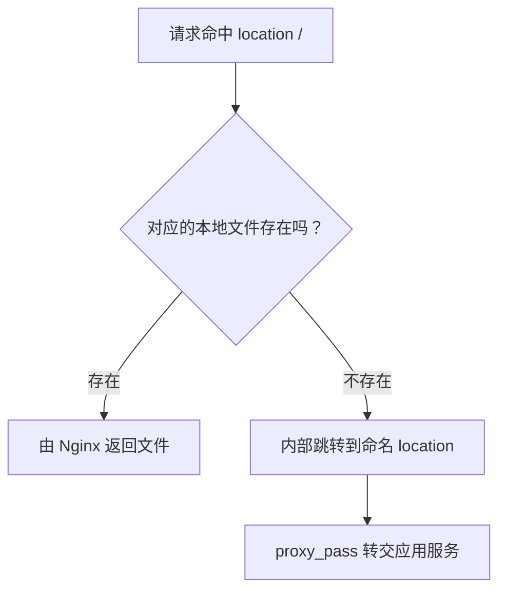

这个项目需要支持多个域名：共用一套代码，根据访问域名展示对应的站点内容。做这个需求时，我遇到了一个问题：刷新页面后，首屏初始化没有正确读到当前页面的域名，展示的内容也没有按预期切换。

我就顺着请求链路开始找原因。查看 Nginx 时，我重点看了请求转给应用的这一段，修改前的配置可以简化成这样：

```nginx
server {
    listen 80;
    server_name app.example.com;
    root /srv/web/public;

    location / {
        try_files $uri @proxy_to_pm2;
    }

    location @proxy_to_pm2 {
        proxy_pass http://127.0.0.1:8084;
    }

    location = /favicon.ico {
        alias /srv/assets/favicon.ico;
    }
}
```

问题就出在转发给应用的域名信息上。**这次域名识别问题，实际只需要在执行代理的 `location @proxy_to_pm2` 里补上两行：**

```nginx
proxy_set_header Host $host;
proxy_set_header X-Forwarded-Host $host;
```

补上之后，检查并重载 Nginx 配置，刷新页面时就能正确识别当前域名了。

修复只用了两行，我更想弄清楚的是：原来的域名为什么没传对？这两行分别做了什么？为什么还得加在真正执行代理的块里？下面我们就深入拆开这份配置，顺着请求的处理过程来看。

<!-- more -->

## 1. `server`：请求由哪组配置处理？

先看 `server`，确定请求由哪组规则接收。`server` 定义一个虚拟主机，把监听端口、域名和具体处理规则组织在一起。

| 指令 | 作用 |
| --- | --- |
| `listen 80` | 在 80 端口接收 HTTP 请求 |
| `server_name app.example.com` | 在相应监听地址和端口上，按请求的主机名匹配这组配置 |
| `root /srv/web/public` | 设置查找本地资源使用的根目录 |

同一个 `server_name` 可以配置多个域名。没有匹配的域名时，请求通常落到该监听地址和端口的默认 `server`，并不会自动拒绝。

`root` 的路径规则是“根目录 + URI”。例如，URI 为 `/assets/app.js`，对应文件就是 `/srv/web/public/assets/app.js`。

**`root` 设置了目录，不代表所有请求都必须返回静态文件。** 后续仍由 `location` 中的规则决定如何处理。

`alias` 则用指定路径替换匹配到的 location 路径。上面 `/favicon.ico` 对应的是 `/srv/assets/favicon.ico`，不再按 `root` 拼接；目录形式使用 `alias` 时，还要注意 location 与目标目录的尾部斜杠。

## 2. `location`：路径命中哪条规则？

读到 `location /` 时，先留意它的 `/` 表示路径前缀。所有以 `/` 开头的路径都符合它，所以它常作为通用规则，不只处理首页。

| 写法 | 含义 |
| --- | --- |
| `location = /` | 精确匹配首页路径 |
| `location /assets/` | 匹配以 `/assets/` 开头的路径 |
| `location ^~ /assets/` | 作为最长前缀命中时，跳过同层正则匹配 |
| `location ~ \.png$` | 按正则匹配，区分大小写；`~*` 表示不区分大小写 |
| `location @proxy_to_pm2` | 命名 location，供内部跳转使用 |

判断常见的同级配置会命中哪个块时，我们按这个顺序看：先检查精确匹配；否则记住最长匹配前缀；若该前缀带 `^~` 就直接使用，否则按声明顺序检查正则，取第一个匹配项；正则都未命中，再使用记住的前缀。

查询参数不参与路径匹配，因此 `/` 和 `/?from=nav` 都能命中 `location = /`。

**同级 location 不是依次执行的流程。** 请求命中一个块后，不会因为下面还写着 `location /`，就继续执行那个兄弟块。内部跳转可能让请求进入另一组配置。

## 3. `try_files`：本地文件找不到，接下来去哪？

继续往下读之前，我想先把这两个变量分清：

| 变量 | 内容 |
| --- | --- |
| `$uri` | 当前规范化的 URI，不含查询参数，内部重写后可能变化 |
| `$request_uri` | 原始请求 URI，包含查询参数 |

没有重写时，请求 `/a.png?v=1` 的 `$uri` 是 `/a.png`，`$request_uri` 是 `/a.png?v=1`。二者都有开头的 `/`。

```nginx
try_files $uri @proxy_to_pm2;
```

这行表示：按当前 `root` 或 `alias` 检查 `$uri` 对应的文件；找到就继续用它处理请求；找不到就内部跳转到 `@proxy_to_pm2`。

**`try_files` 本身不连接应用服务。** 真正发起代理请求的是后面的 `proxy_pass`。



如果再加上 `$uri/`，并把最后的目标换成 `/index.html`，就变成另一种常见写法：

```nginx
try_files $uri $uri/ /index.html;
```

三个参数依次表示：检查文件、检查目录、前面均未命中时内部跳转到 `/index.html`。最后一个参数也可以是 `=404`，表示直接返回 404。

`/index.html` 常用于纯静态 SPA 的 history 路由兜底；应用服务部署则通常回退到命名 location。两者取决于部署产物，不能直接互换。hash 路由的 `#` 及其后内容不发送给服务器，服务端只需处理 `#` 前面的路径。

### 为什么有时需要单独写 `location = /`？

```nginx
location = / {
    proxy_pass http://127.0.0.1:8084;
}

location / {
    try_files $uri $uri/ @proxy_to_pm2;
}
```

首页会精确命中第一个块，直接代理，绕过目录检查。注意首页也有自己的代理入口，后面讲到的域名请求头，在这里同样要按需要配置。

如果删除整个首页块，`/` 就会进入下面的 `try_files`。根目录存在时，`$uri/` 的目录检查会成功，后续由 `index` 等规则处理；没有可用首页且关闭目录列表时，通常返回 403，**不会自动回来继续尝试最后的代理**。

所以，判断首页块能不能删时，我会连着看下面有没有 `$uri/`。若只需“存在的文件直接返回，其余交给应用”，可以同时去掉首页专用块和 `$uri/`，使用前面的 `try_files $uri @proxy_to_pm2`。代价是原本由 Nginx 提供的目录页面也会交给应用处理。

## 4. 命名 location 与 `proxy_pass`：交给哪个服务？

`@proxy_to_pm2` 是自定义名称，不是变量，也不是外部 URL；把定义和引用同时改成 `@app`，作用不变。`$` 开头通常表示变量，`@` 开头这里表示命名 location。

名字带 `pm2` 不代表请求发送给 PM2。PM2 管理进程，接收 HTTP 请求的是实际监听端口的应用服务。

```nginx
proxy_pass http://127.0.0.1:8084;
```

这行让 Nginx 建立到本机 8084 端口的新连接，把请求交给上游服务，再将响应返回客户端。浏览器地址栏不变，这与要求浏览器重新访问另一个地址的 301、302 重定向不同。

这里我会特意留意 `proxy_pass` 末尾的 `/`，因为多这一个字符，上游收到的路径就可能不同。在没有其他重写的普通 `location /api/` 中：

| 代理配置 | 收到 `/api/users` 时，上游收到的路径 |
| --- | --- |
| `proxy_pass http://127.0.0.1:8084;` | `/api/users` |
| `proxy_pass http://127.0.0.1:8084/;` | `/users`，匹配前缀被替换为 `/` |

命名 location 中的 `proxy_pass` 不能附带 URI 部分，因此应使用不带末尾 `/` 的写法。

## 5. 这两行 `proxy_set_header` 为什么能解决域名识别？

现在回到开头补上的两行。我想先把两件事分开：**请求发给哪个服务**，由 `proxy_pass` 决定；**请求访问哪个主机名**，通过 `Host` 告诉应用。连接的是本机端口，并不意味着访问的域名也必须是本机地址。

HTTP 代理默认会把 `Host` 设置为 `$proxy_host`，即代理目标的主机名和端口；这里是 `127.0.0.1:8084`。应用拿这个值匹配访问域名，就无法匹配到预期的站点。开头补上的配置是：

```nginx
proxy_set_header Host $host;
proxy_set_header X-Forwarded-Host $host;
```

第一行把上游请求的 `Host` 设为当前请求的 `$host`，覆盖默认的代理目标地址；第二行把 `X-Forwarded-Host` 也设为 `$host`，供应用按其转发头读取规则获取访问域名。

所以，在开头这份配置里，应用收到的两个头都会是 `app.example.com`。这是重新设置上游请求头；前提是当前 Nginx 已收到正确域名，若前一层已经改错，这两行也不能自动找回。

| 变量 | 含义 |
| --- | --- |
| `$host` | 按请求行主机名、Host 头、匹配到的 server 名称依次确定的主机名，不含端口 |
| `$http_host` | 收到的 Host 头，可能包含端口，缺失时没有上述回退 |
| `$proxy_host` | `proxy_pass` 指定的上游主机名和端口 |

### 配置要放在真正执行代理的层级

检查请求头时，我会先找到真正写着 `proxy_pass` 的块。从 `location /` 跳到 `location @proxy_to_pm2` 后，使用的是后者生效的代理配置。仅在前一个兄弟块里写 `proxy_set_header`，不会让后一个块继承它。

公共设置可以放在父级，但 `proxy_set_header` 的继承有一个关键规则：**当前层没有任何同类指令时，才继承父级那一组；不会逐项合并。** 有多个代理入口时，要分别确认其请求头设置。

在默认开启请求头传递、没有额外覆盖或过滤时，`User-Agent`、`Cookie`、`Authorization` 等通常继续传递；已有的 `X-Forwarded-*` 也通常继续传递，没有则不会自动生成。无需把所有头重新写一遍。

## 6. IP、协议、UA：变量描述的是哪一段连接？

域名理清之后，我们再看 IP、协议和 UA。这里先分清变量描述的是当前连接，还是请求头里传来的信息：

| 变量 | 表示什么 |
| --- | --- |
| `$remote_addr` | 直接连接当前 Nginx 的对端地址；启用 Real IP 改写后可能不同 |
| `$http_x_forwarded_for` | 收到的 `X-Forwarded-For` 头 |
| `$proxy_add_x_forwarded_for` | 在收到的 XFF 后追加 `$remote_addr`；没有 XFF 时就是 `$remote_addr` |
| `$scheme` | 当前请求到达这一层 Nginx 时使用的协议 |
| `$http_user_agent` | 收到的 `User-Agent` 头 |

前面还有代理时，`$remote_addr` 可能是代理 IP。直接用它覆盖 XFF，可能丢失已有访客地址；追加 XFF 也不会自动验证地址真实性，需要结合可信代理设置判断。

同理，如果 HTTPS 在前一层终止、当前 Nginx 接收 HTTP，`$scheme` 就是 `http`。此时把 `X-Forwarded-Proto` 设为 `$scheme`，可能覆盖原本正确的 `https`。应按实际代理链路决定如何传递。

UA 在请求到达时就可以读取，无需等待浏览器执行 JavaScript。应用之后主动调用另一个 API，是新的 HTTP 请求，访客信息是否继续携带取决于应用的请求逻辑。

## 7. 配置如何检查并生效？

```bash
# 查看磁盘配置及展开的 include。
nginx -T

# 语法检查通过后，重载配置。
nginx -t && nginx -s reload
```

`-T` 展示磁盘配置，不能证明运行中的 worker 已经加载；`-t` 检查配置，也不能证明上游服务可用。重载成功后，仍应请求目标路径，核对状态码与响应内容。

回到开头那份配置，我会沿着这条顺序核对请求：**监听地址和域名 → location 匹配 → 本地文件检查或内部跳转 → 实际代理目标 → 上游收到的请求头**。每一步先确定谁负责处理，再看它拿到了什么信息。

指令细节可查阅 Nginx 官方文档：[location](https://nginx.org/en/docs/http/ngx_http_core_module.html#location)、[try_files](https://nginx.org/en/docs/http/ngx_http_core_module.html#try_files)、[proxy_pass](https://nginx.org/en/docs/http/ngx_http_proxy_module.html#proxy_pass)、[proxy_set_header](https://nginx.org/en/docs/http/ngx_http_proxy_module.html#proxy_set_header)。
